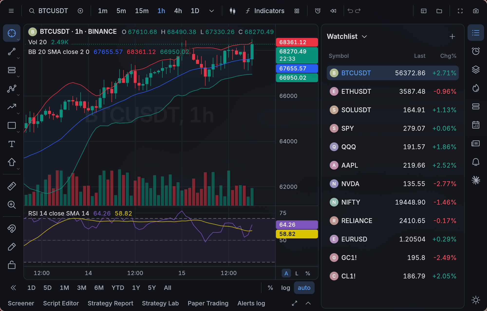
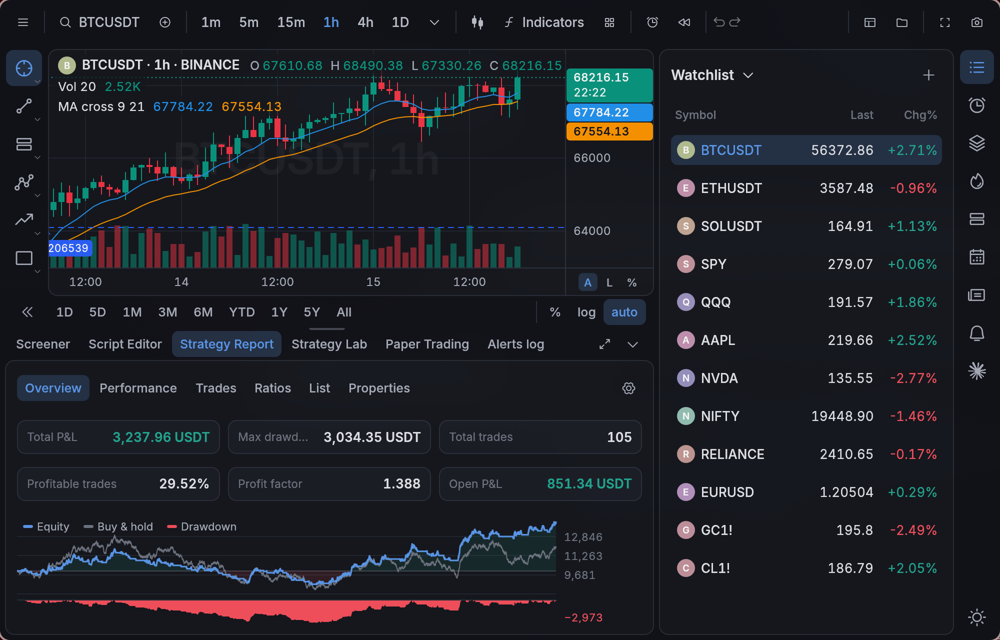
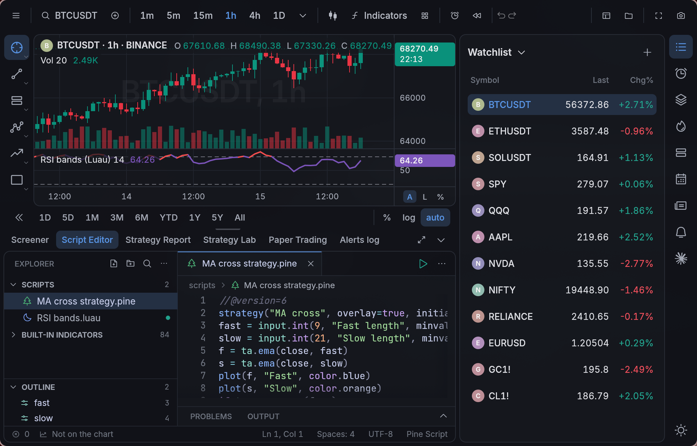
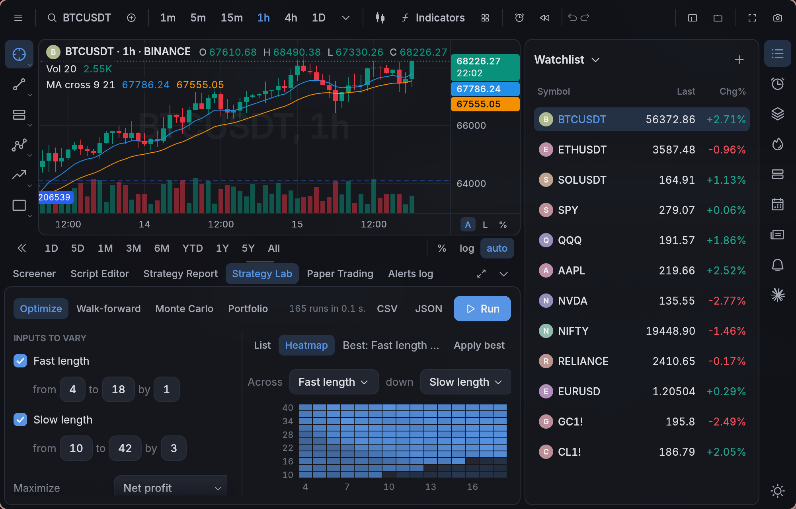
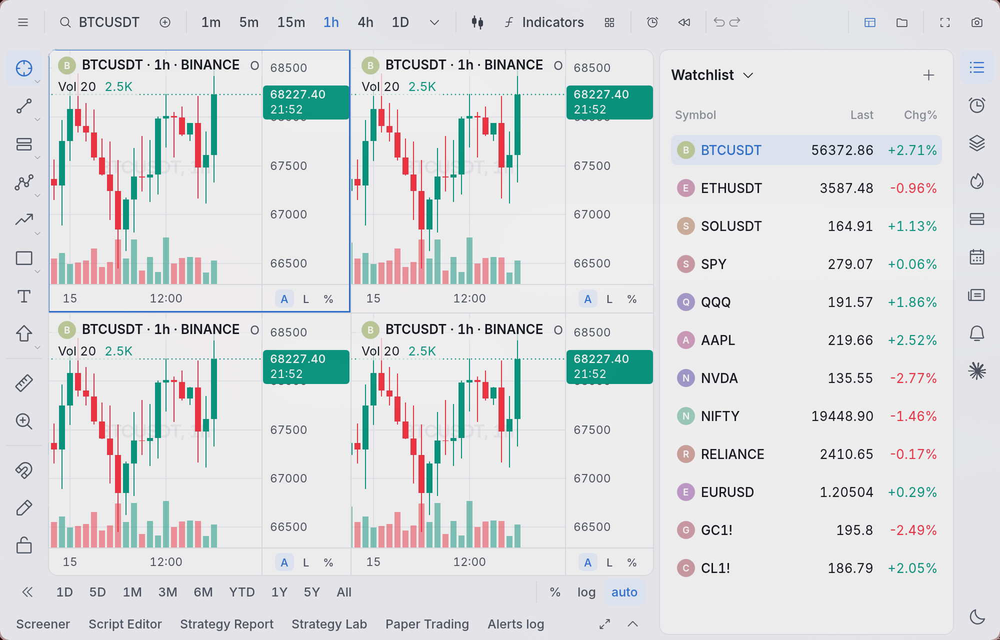
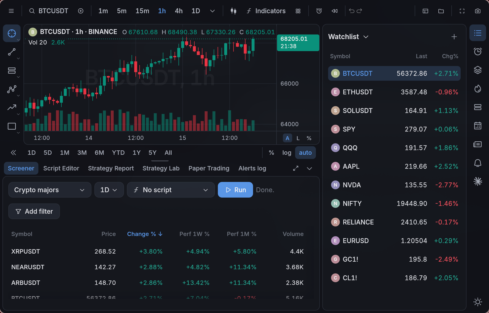
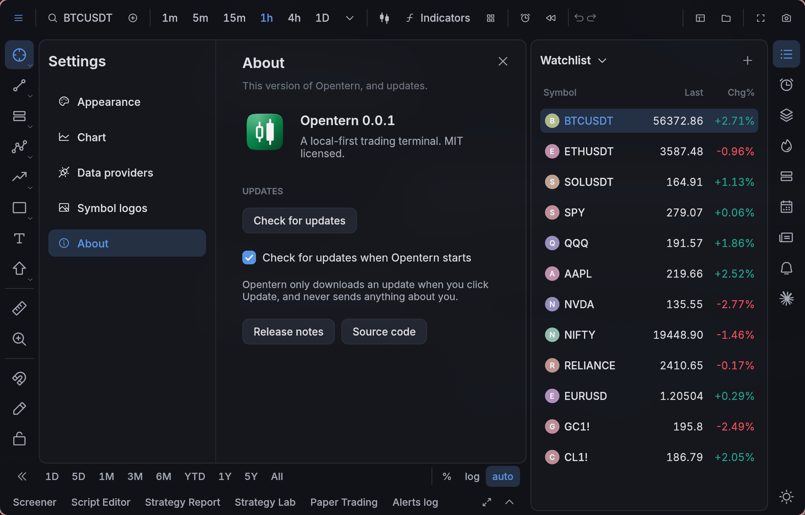

<div align="center">


# Opentern

**A fast, local-first trading terminal.**

TradingView-style charts, indicators and strategies in Pine Script®-compatible
code, Python, Luau, JavaScript or TypeScript, a backtester with TradingView's
Strategy Report, alerts and paper trading. It's a native Rust app with no
account and no telemetry, and your data stays on your computer.

[Install](#install) · [Features](#features) · [Scripting](#scripting) · [Keyboard](#keyboard) · [Your data](#your-data) · [Building](#building-from-source)



</div>

## Features

**Laid out like TradingView.** The drawing toolbar sits on the left, symbol and
interval are in the top bar, the widget rail is on the right and the Script
Editor, Strategy Report and Paper Trading tabs are along the bottom. Traders
already know where everything is, so there's nothing new to learn. It just opens
faster and asks your computer for less.

**Charts.**
- Candles, hollow candles, bars, line, line with markers, step, area, baseline,
  columns, high-low, Heikin Ashi, Renko, Line Break, Kagi and Point & Figure.
- Any interval, including custom ones like 7m, 45m or 2h, with scroll-back history.
- Log, percent and locked scales. Compare or overlay other symbols, or chart a
  formula like `BTCUSDT/ETHUSDT`.
- Up to 8 charts in one layout, with symbol, interval, crosshair and time kept in sync.
- Bar replay: pick a date and play the market forward bar by bar.
- 27 drawing tools in TradingView's groups: trend lines, Fib, pitchfork, channels,
  long/short positions, measures, anchored VWAP and volume profiles. Drawings are
  saved per symbol.

**96 of TradingView's built-in indicators**, written in Rust and composed from
Pine-exact `ta.*` primitives so they match TradingView's numbers. They keep
TradingView's default inputs, styles, colours and levels, and come with settings
dialogs, saved defaults and indicator templates. They include the Volume Profile
family, Ichimoku, SuperTrend, Zig Zag, Auto Fib and Pivot Points.



**Backtests, the way TradingView reports them.**
- A broker emulator that follows TradingView's fill rules: next-open fills, the
  intrabar path for stops and limits, pyramiding, brackets, commission and slippage.
- The Strategy Report has the same tabs and metric names: Overview, Performance,
  Trades analysis, Risk/performance ratios, List of trades and Properties. The
  List of trades exports to CSV.
- Entry and exit arrows on the chart with "Long +1" labels, as TradingView draws them.
- The **Strategy Lab** has a grid, random or Bayesian optimizer with a heatmap,
  walk-forward analysis, Monte Carlo and portfolio backtests across a watchlist.

<table>
<tr>
<td></td>
<td></td>
</tr>
<tr>
<td></td>
<td></td>
</tr>
<tr>
<td></td>
<td></td>
</tr>
</table>

**Paper trading.** Several simulated accounts with market, limit, stop,
stop-limit, trailing and bracket orders. Trade from the chart by dragging an
order's tag, or from the depth-of-market ladder.

**Alerts.** Alerts can watch a price, a drawn line, an indicator plot or a
script's `alert()`. They reach you as a desktop notification with sound, a
webhook, Telegram or email.

**Markets.**
- **Crypto:** Binance, Bybit, OKX, Coinbase and Kraken. Free, live and with deep history.
- **US stocks, ETFs, indices, forex and commodities:** Yahoo by default, delayed.
  Add your own Alpaca, OANDA or Interactive Brokers keys for live data.
- **India (NSE/BSE):** Yahoo by default, or Upstox with your own keys.

Exchange calendars, dividends and splits are built in. Everything is free until
you choose to add a paid provider.

**A Claude panel.** If you use [Claude Code](https://claude.com/claude-code),
open it beside the chart and ask it to write a strategy, explain an indicator or
read your backtest. Opentern starts the `claude` program already on your
computer, so it uses your own sign-in and plan. Opentern has no key of its own.
Nothing runs until you send a message, and without Claude Code the panel just
says how to install it.

**Everything else.**
- 16 themes, 8 light and 8 dark, that crossfade when you switch, and 9 bundled interface fonts.
- A screener over any watchlist, with an optional script column.
- Watchlists, hotlists, news, a calendar and an object tree in the right-hand widgets.
- Named layouts, chart templates and indicator templates, all of which you can
  export and import as JSON.
- Opentern updates itself: a quiet **Update available** appears on the right,
  and nothing happens until you click it. Settings → About shows the version and
  has **Check for updates**.

## Install

### Linux (one line)

```bash
curl -fsSL https://raw.githubusercontent.com/ahaan-shah/opentern/main/install.sh | sh
```

While the repository is private, go through the [GitHub CLI](https://cli.github.com)
instead. It uses your sign-in for the download:

```bash
gh api repos/ahaan-shah/opentern/contents/install.sh -H 'Accept: application/vnd.github.raw' | sh
```

This installs `opentern` into `~/.local/bin` and adds a desktop entry and icon,
so Opentern shows up in your app launcher. The script checks the download
against the release's `SHA256SUMS`. To pin a version, set `OPENTERN_VERSION=0.1.0`.

Builds are published for Linux x86-64 for now. On macOS and Windows, [build from
source](#building-from-source).

**Uninstall:** run the install line with `sh -s -- --uninstall` in place of
`sh`. Your workspace is kept.

## Scripting

Every language runs on the same bar-by-bar engine with Pine's semantics: history
references like `close[1]`, persistent state, and a forming bar that recalculates
on every tick. So a script plots the same way whatever it's written in.

| Language | How it runs |
|---|---|
| **Pine Script® v5/v6** | A native Rust engine. Covers `ta.*`, `strategy.*`, `request.security`, drawings, arrays/maps/matrices, types, methods and libraries |
| **Python** | Your own interpreter, in a separate process, with the `opentern` SDK (pandas welcome) |
| **Luau** | Embedded and sandboxed, with instant startup |
| **JavaScript / TypeScript** | Embedded QuickJS, sandboxed |

Scripts live in your workspace's `scripts` folder. Write them in the built-in
editor or in your own: the chart reloads when you save. A script that fails
shows a plain error with the line number in its legend row, and never takes the
app down. See [docs/scripting.md](docs/scripting.md) for the Python, Luau and
JS API.

```pine
//@version=6
strategy("MA cross", overlay=true)
f = ta.ema(close, input.int(9, "Fast"))
s = ta.ema(close, input.int(21, "Slow"))
plot(f, "Fast", color.blue)
plot(s, "Slow", color.orange)
if ta.crossover(f, s)
    strategy.entry("Long", strategy.long)
if ta.crossunder(f, s)
    strategy.close("Long")
```

## Keyboard

The shortcuts are TradingView's.

| Keys | Does |
|---|---|
| Type anywhere | Symbol search |
| Type a number | Change the interval (`5`, `45`, `4h`, `D`) |
| `/` | Indicators |
| `Alt T` · `Alt H` · `Alt V` · `Alt F` | Trend line · horizontal line · vertical line · Fib retracement |
| `Alt A` | Create an alert |
| `Alt R` | Reset the chart view |
| `Alt S` | Save a snapshot |
| `Shift F` | Full screen |
| `Ctrl Z` / `Ctrl Y` | Undo / redo |
| `←` `→` | Step one bar |
| `Delete` · `Esc` | Delete the selected drawing · cancel |

On macOS, use `Cmd` instead of `Ctrl`.

## Your data

Everything stays on your computer. There's no account, no sign-in and no
telemetry. Opentern only goes online for the market data providers you use, a
check for a new release on GitHub (you can turn it off in Settings), and symbol
logos (also optional). API keys are kept in your system's keychain, never in a
file.

| | Linux | macOS | Windows |
|---|---|---|---|
| Workspace | `~/.local/share/opentern/` | `~/Library/Application Support/dev.opentern.opentern/` | `%APPDATA%\opentern\opentern\data\` |

The workspace holds the database (settings, layouts, drawings, alerts, paper
accounts and the bar cache) and your scripts. To move to another computer, copy
the folder.

Want to look around first? `opentern --demo` opens a workspace of its own with
made-up prices. It doesn't go online and doesn't touch your real data.

## Building from source

```bash
git clone https://github.com/ahaan-shah/opentern.git
cd opentern
cargo run --release
```

Rust 1.88+ is required. On Linux you also need the usual GUI libraries (on
Debian or Ubuntu: `pkg-config libdbus-1-dev libxkbcommon-dev libwayland-dev
libgl1-mesa-dev libgtk-3-dev`). For day-to-day work, `cargo run --profile fast
-- --demo` builds quicker.

## License

[MIT](LICENSE). Indicators ported from MPL-2.0 Pine scripts stay MPL-2.0 file
by file, with their authors credited in [docs/indicators.md](docs/indicators.md).

Pine Script® and TradingView® are trademarks of TradingView, Inc. Opentern is
an independent project, not affiliated with or endorsed by TradingView.
