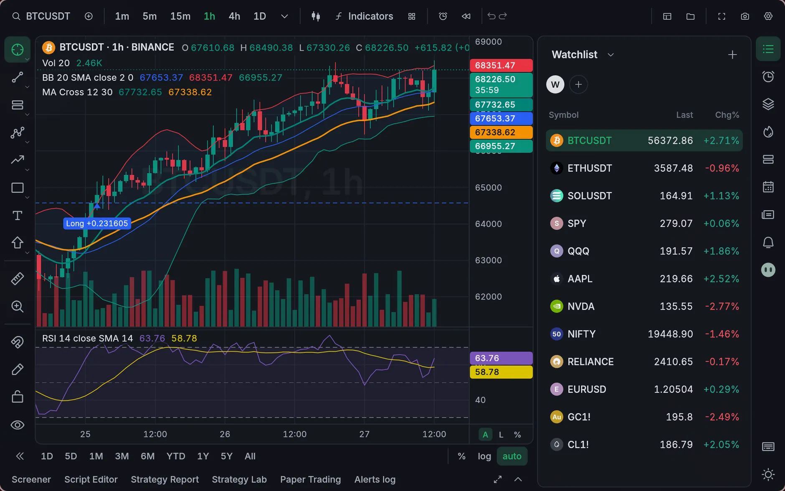
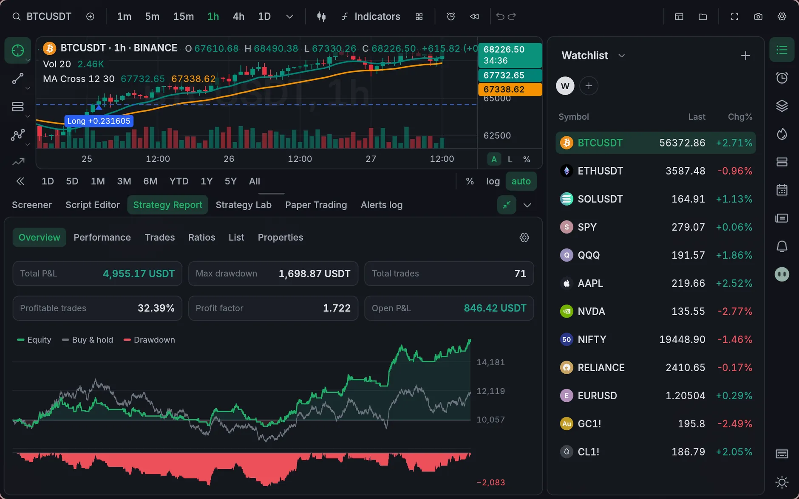
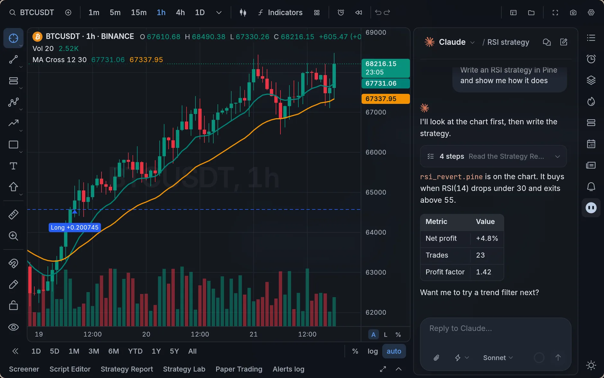
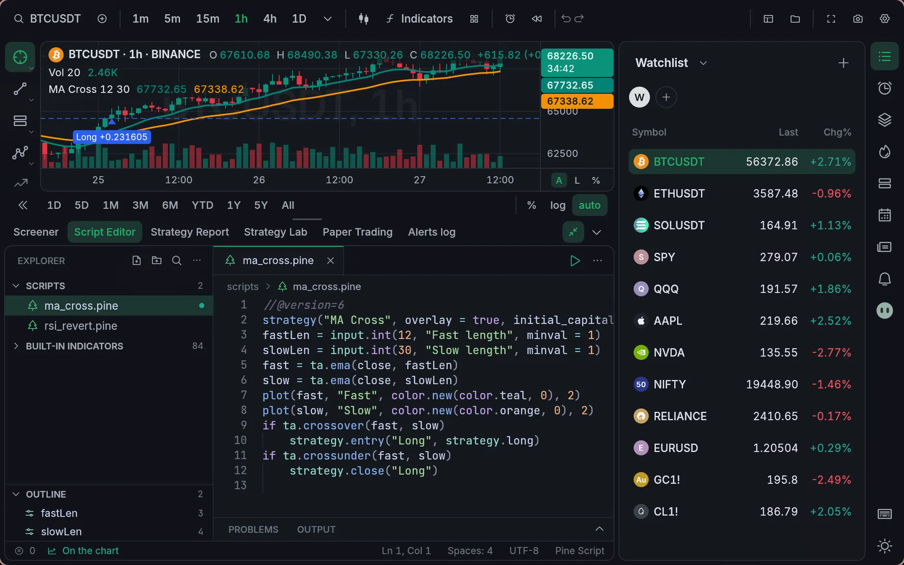
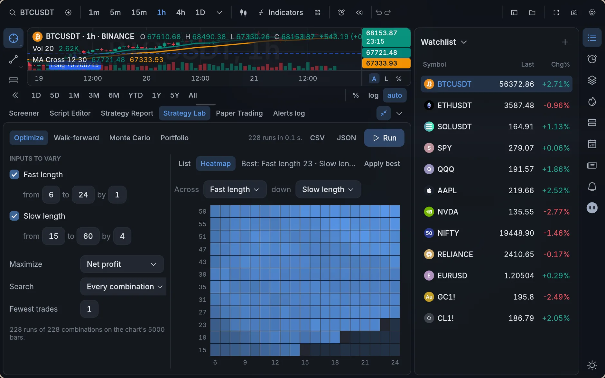
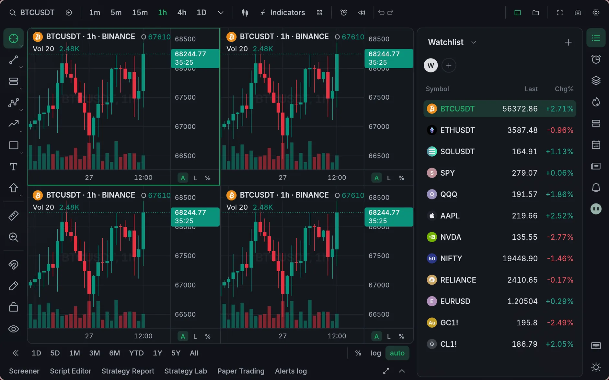
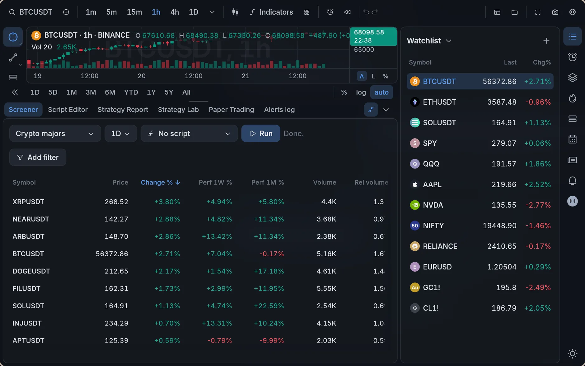
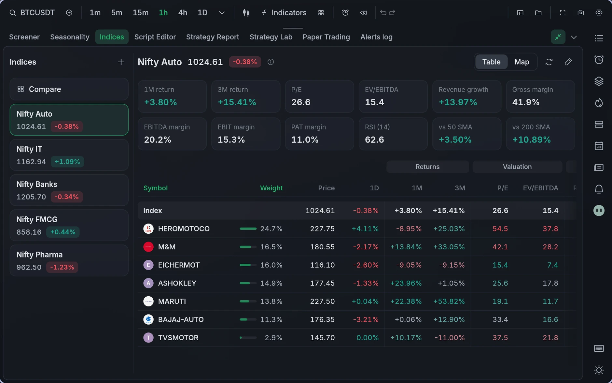
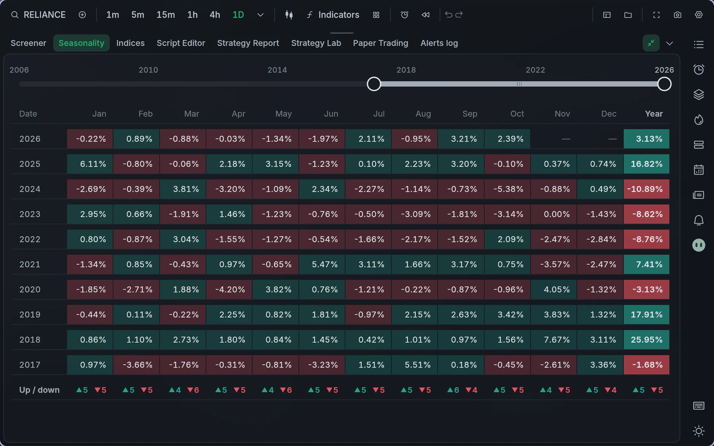

<div align="center">


# Opentern

**A fast, local-first market analysis terminal.**

TradingView-style charts, TradingView's built-in indicators, Pine Script®-compatible
scripting (plus Python, Luau, JavaScript and TypeScript), backtests with
TradingView's Strategy Report, alerts, paper trading and a coding agent beside
the chart. It's for analysis: it never places real orders. A native Rust app for Linux, macOS and Windows, with no account and no
telemetry. Your data stays on your computer.

[Website](https://ahaan-shah.github.io/opentern/) · [Install](#install) · [Features](#features) · [Scripting](#scripting) · [Keyboard](#keyboard) · [Your data](#your-data) · [Building](#building-from-source)



</div>

## Features

**Laid out like TradingView.** Drawing tools on the left, symbol and interval in
the top bar, widgets on the right, and the Script Editor, Strategy Report and
Paper Trading along the bottom. Traders already know where everything is. It just
opens faster and asks your computer for less.

**Charts.**
- Candles, hollow candles, bars, line, line with markers, step, area, baseline,
  columns, high-low, Heikin Ashi, Renko, Line Break, Kagi and Point & Figure.
- Any interval, including custom ones like 7m, 45m or 2h, with scroll-back history.
- Log, percent and locked scales. Compare or overlay other symbols, or chart a
  formula like `BTCUSDT/ETHUSDT`.
- Up to 8 charts in one layout, with symbol, interval, crosshair and time kept in sync.
- Bar replay: pick a date and play the market forward bar by bar.
- 27 drawing tools in TradingView's groups: trend lines, Fib, pitchfork, channels,
  long/short positions, measures, anchored VWAP and volume profiles. Drawings are
  saved per symbol.
- Logos for coins and companies, as on TradingView.

**96 of TradingView's built-in indicators**, written in Rust from Pine-exact `ta.*`
primitives, so they match TradingView's numbers. They keep TradingView's default
inputs, styles, colours and levels, with settings dialogs, saved defaults and
indicator templates (star one to keep it in the top bar). They include the Volume
Profile family, Ichimoku, SuperTrend, Zig Zag, Auto Fib and Pivot Points.



**Backtests that match TradingView.** Checked against a TradingView Strategy
Report on BTCUSDT 1D over 40 trades: net profit, max drawdown, profit factor and
every trade size agree to the cent.
- A broker emulator with TradingView's fill rules: next-open fills, the intrabar
  path for stops and limits, pyramiding, brackets, margin, commission and slippage.
- The Strategy Report has TradingView's tabs and metric names: Overview,
  Performance, Trades analysis, Risk/performance ratios, List of trades and
  Properties. The List of trades exports to CSV.
- Entry and exit arrows on the chart with "Long +1" labels, as TradingView draws them.
- The **Strategy Lab**: a grid, random or Bayesian optimizer with a heatmap,
  walk-forward analysis, Monte Carlo and portfolio backtests across a watchlist.



**An agent beside the chart.** If you use [Claude Code](https://claude.com/claude-code)
or OpenAI's [Codex CLI](https://github.com/openai/codex), ask it to write a
strategy, explain an indicator or read your backtest. It sees the chart, writes
scripts in your scripts folder, checks they compile, puts them on the chart and
reads the Strategy Report. Pick your agent the first time you open the panel and
switch any time; each keeps its own chats. With more than one Claude Code or
Codex account on your computer, pick which one it uses. Opentern starts the CLI already on your
computer, so it uses your own sign-in and plan. Opentern has no key of its own,
and nothing runs until you send a message.

<table>
<tr>
<td></td>
<td></td>
</tr>
<tr>
<td></td>
<td></td>
</tr>
</table>



**Your own indices.** Pick any stocks, or a whole watchlist, and Opentern
builds an index the way NSE builds its own: weighted by free-float market cap
(or full market cap, or equally), starting at 1000, and rebalanced on 1 April
and 1 October without the level jumping. Chart it like any symbol, with
indicators and alerts. Its board shows the index's returns, P/E, EV/EBITDA,
revenue growth, margins, RSI and moving averages, then every member's, as a
colour-coded table or a treemap. **Compare** puts all your indices side by side.

**Seasonality.** See how the chart's symbol did in every month of every year,
with a slider to pick the years and a count of rises and falls per month.



**Paper trading.** Several simulated accounts with market, limit, stop,
stop-limit, trailing and bracket orders. Trade from the chart by dragging an
order's tag, or from the depth-of-market ladder.

**Alerts.** Alerts can watch a price, a drawn line, an indicator plot or a
script's `alert()`. They reach you as a desktop notification with sound, a
webhook, Telegram or email.

**Markets.**
- **Crypto:** Binance, Bybit, OKX, Coinbase and Kraken. Free, live and with deep history.
- **US stocks, ETFs, indices, forex and commodities:** Yahoo by default, delayed.
  Add your own Alpaca, OANDA or Interactive Brokers keys for live data.
- **India (NSE/BSE):** Yahoo by default, or Upstox with your own keys.

Exchange calendars, dividends and splits are built in. Everything is free until
you choose to add a paid provider.

**Everything else.**
- 16 themes, 8 light and 8 dark, that crossfade when you switch, and 9 interface fonts.
- A screener over any watchlist, with an optional script column.
- Watchlists with sections, laid out like TradingView's, plus hotlists (crypto, US
  and Indian stocks), news, a calendar, depth of market and an object tree in the
  right-hand widgets.
- Named layouts, chart templates and indicator templates, all of which you can
  export and import as JSON.
- Opentern updates itself: a quiet **Update available** appears on the right,
  and nothing happens until you click it.

## Install

### Linux & macOS (one line)

```bash
curl -fsSL https://raw.githubusercontent.com/ahaan-shah/opentern/main/install.sh | sh
```

What the script does on each platform:
- **Linux:** installs `opentern` into `~/.local/bin`, and adds a desktop entry and
  icon so Opentern shows up in your app launcher. x86-64 and ARM64.
- **macOS:** installs `Opentern.app` (universal, Apple Silicon + Intel) into `/Applications`.

The script checks every download against the release's `SHA256SUMS`. To pin a
version, set `OPENTERN_VERSION=0.2.3`.

The app isn't notarized yet. If macOS refuses to open it the first time,
right-click the app and choose **Open**, or run
`xattr -dr com.apple.quarantine /Applications/Opentern.app`.

### Windows (one line)

In PowerShell:

```powershell
irm https://raw.githubusercontent.com/ahaan-shah/opentern/main/install.ps1 | iex
```

This installs Opentern just for you (no admin prompt) into
`%LOCALAPPDATA%\Programs\Opentern` and adds it to the Start menu, on x64 and
ARM64 PCs. To pin a version, run `$env:OPENTERN_VERSION = "0.2.3"` first.

Prefer a regular installer? Download
[`Opentern-windows-setup.exe`](https://github.com/ahaan-shah/opentern/releases/latest/download/Opentern-windows-setup.exe)
and run it. It isn't code-signed yet, so SmartScreen may say "Windows protected
your PC". Click **More info**, then **Run anyway**.

### Other downloads

The [latest release](https://github.com/ahaan-shah/opentern/releases/latest)
also has portable archives (`.tar.gz` for Linux x86-64 and ARM64, `.zip` for
Windows x64 and ARM64) and the macOS disk image.

**Uninstall:** on Linux and macOS, run the install line with
`sh -s -- --uninstall` in place of `sh`. On Windows, use **Settings → Apps**.
Your workspace is kept either way.

## Scripting

Every language runs on the same bar-by-bar engine with Pine's semantics: history
references like `close[1]`, persistent state, and a forming bar that recalculates
on every tick. So a script plots the same way whatever it's written in.

| Language | How it runs |
|---|---|
| **Pine Script® v5/v6** | A native Rust engine. Covers `ta.*`, `strategy.*`, `request.security`, drawings, arrays/maps/matrices, types, methods and libraries |
| **Python** | Your own interpreter, in a separate process, with the `opentern` SDK (pandas welcome) |
| **Luau** | Embedded and sandboxed, with instant startup |
| **JavaScript / TypeScript** | Embedded QuickJS, sandboxed |

Scripts live in your workspace's `scripts` folder. Write them in the built-in
editor or in your own: the chart reloads when you save. A script that fails
shows a plain error with the line number in its legend row, and never takes the
app down. See [docs/scripting.md](docs/scripting.md) for the Python, Luau and
JS API.

```pine
//@version=6
strategy("MA cross", overlay=true)
f = ta.ema(close, input.int(9, "Fast"))
s = ta.ema(close, input.int(21, "Slow"))
plot(f, "Fast", color.blue)
plot(s, "Slow", color.orange)
if ta.crossover(f, s)
    strategy.entry("Long", strategy.long)
if ta.crossunder(f, s)
    strategy.close("Long")
```

## Keyboard

The shortcuts are TradingView's, and every drawing tool has one. The full list
is in Settings → Keyboard shortcuts (the keyboard button beside the theme
switch).

| Keys | Does |
|---|---|
| Type anywhere | Symbol search |
| Type a number | Change the interval (`5`, `45`, `4h`, `D`) |
| `/` | Indicators |
| `Alt T` · `Alt H` · `Alt V` · `Alt C` · `Alt F` | Trend line · horizontal line · vertical line · cross line · Fib retracement |
| `Alt Shift R` | Rectangle (the other tools are `Alt Shift` and a letter) |
| `Alt L` · `Alt P` · `Alt U` | Log · percent · auto scale |
| `Alt A` | Create an alert |
| `Alt R` | Reset the chart view |
| `Alt S` | Save a snapshot |
| `Ctrl Alt H` | Hide all drawings |
| `Shift F` | Full screen |
| `Ctrl Z` / `Ctrl Y` | Undo / redo |
| `←` `→` | Step one bar |
| `Delete` · `Esc` | Delete the selected drawing · cancel |
| `Alt V` (agent panel) | Paste an image from the clipboard |

On macOS, use `Cmd` instead of `Ctrl`.

## Your data

Everything stays on your computer. There's no account, no sign-in and no
telemetry. Opentern only goes online for the market data providers you use, a
check for a new release on GitHub (you can turn it off in Settings), symbol
logos (also optional), and the agent CLI you choose, when you send it a message.
API keys are kept in your system's keychain, never in a file.

| | Linux | macOS | Windows |
|---|---|---|---|
| Workspace | `~/.local/share/opentern/` | `~/Library/Application Support/dev.opentern.opentern/` | `%APPDATA%\opentern\opentern\data\` |

The workspace holds the database (settings, layouts, drawings, alerts, paper
accounts and the bar cache), your scripts and your agent chats. To move to
another computer, copy the folder.

Want to look around first? `opentern --demo` opens a workspace of its own with
made-up prices. It doesn't go online and doesn't touch your real data.

## Building from source

```bash
git clone https://github.com/ahaan-shah/opentern.git
cd opentern
cargo run --release
```

Rust 1.88+ is required. On Linux you also need the usual GUI libraries (on
Debian or Ubuntu: `pkg-config libdbus-1-dev libxkbcommon-dev libwayland-dev
libgl1-mesa-dev libgtk-3-dev`). For day-to-day work, `cargo run --profile fast
-- --demo` builds quicker.

## License

[MIT](LICENSE). Indicators ported from MPL-2.0 Pine scripts stay MPL-2.0 file
by file, with their authors credited in [docs/indicators.md](docs/indicators.md).
The licenses of everything Opentern includes are in
[THIRD-PARTY-LICENSES.txt](THIRD-PARTY-LICENSES.txt) (`opentern --licenses`).

Pine Script® and TradingView® are trademarks of TradingView, Inc. Claude is a
trademark of Anthropic. OpenAI and Codex are trademarks of OpenAI. Opentern is an
independent project, not affiliated with or endorsed by any of them.
