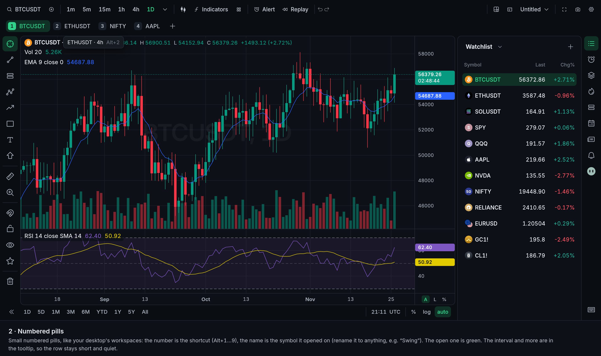

# Ideas for later

Ideas the maintainer wants kept but not built yet. Don't start one without
their go; when one is built, move its notes into the right `docs/notes/` file and delete it here.

## Workspaces: one chart per numbered pill (Nov 2026)
Several charts in the same layout, each its own: BTCUSDT in workspace 1,
ETHUSDT in 2, and so on, each with its own symbol, interval, indicators,
drawings and scripts, and its own multi-chart setup (the layout menu's
"Charts in this window" grid and its "Keep in sync" choices: one workspace
can be a single chart, another a 2×2 grid). Everything else is shared (the
app's panels and their sizes, the watchlist), so switching looks like the
same app with other charts in it.

- **Where:** a new row right under the top bar, across the chart area (the chart
  gives up that much height). Hidden while there's only one workspace, so
  nothing changes until a second is made.
- **Look (the maintainer's pick of four mockups; locked in):**
  
  Small numbered pills, as
  Hyprland's workspaces: `1 BTCUSDT  2 ETHUSDT  3 NIFTY  4 AAPL  +`. The number
  sits in a small rounded square; the open pill is green (accent-soft
  background, accent text, the number's square filled with the accent and dark
  text); others are muted text on nothing, with the usual hover wash. The name
  is the symbol it opened on, or a name the person gives it. A tooltip says the
  symbol, interval and shortcut ("ETHUSDT · 4h  Alt+2"). `+` (an icon button)
  makes a new one on the current symbol.
- **Right-click a pill** opens a menu in the app's own menu style
  (`widgets::menu_row` and friends, like the drawing toolbar's flyouts and the
  study menu): Rename, Duplicate (same symbol, interval and indicators, to try
  a variation), Close (Ctrl+W), Close others.
- **Keys:** Alt+1…9 to a workspace, Ctrl+Tab / Ctrl+Shift+Tab to the next and
  previous, Ctrl+T new, Ctrl+W close; all of them changeable in Settings →
  Keyboard shortcuts. Drag a pill to reorder.
- **Decided (the maintainer, Nov 2026):**
  - Hidden workspaces don't stream: only the shown one has live data
    sessions; the others load again on switching (from the bar cache first,
    so it's quick).
  - Alerts and strategies belong to the chart they were made on, like
    indicators: a strategy added on workspace 1's chart runs there, not on
    the others. (Alerts keep firing in the background as today, whichever
    workspace is shown.)
  - The agent acts on the shown workspace unless told otherwise ("on
    workspace 2", "on the ETH one"); its tools take an optional workspace.
  - Workspaces are saved per named layout. A layout is a whole set of them
    (for example, one layout of crypto charts and another of Indian stocks,
    each with ten or more workspaces), each with
    its own charts, indicators, drawings and scripts. Opening a layout brings
    all its workspaces back at once, as they were left, with the one that was
    open shown. (So "Save layout" and the layout menu save and switch whole
    sets, not one chart.) Ten or more workspaces must stay cheap: hidden ones
    hold only their saved state until shown, nothing loads or streams.
  - Strategies on hidden workspaces pause until their workspace is shown
    again, then catch up on the bars they missed (the Strategy Report covers
    the shown workspace's strategies).

## Strategies: bar magnifier and every-tick recalculation (Nov 2026)
Waiting on outside pull requests for issues #5 (`calc_on_order_fills`) and #6
(Strategy Report Overview chart); the maintainer reviews them first. These two
follow on from #5:

- **Bar magnifier (`use_bar_magnifier`)**: fill stops, limits and exits along
  the real price path from a lower timeframe's bars inside each bar (as
  TradingView picks it: 1h → 1m, 1D → 5m and so on), instead of the guessed
  open → nearer extreme → other → close. The biggest accuracy gain for
  backtests, and it makes `calc_on_order_fills` trustworthy (its extra runs
  happen at real points rather than guessed ones). Needs lower-timeframe
  history for the whole range (the feeds `request.security_lower_tf` uses),
  so it's slower and limited by how far back intraday data goes.
- **Every-tick recalculation (`calc_on_every_tick`)**: on the live bar, rerun
  the strategy on each price update rather than once at the close, so it can
  act before the bar closes (as on TradingView live; history still runs at
  closes). The engine already recomputes the forming bar on a clone
  (`Instance::update`); the broker would need the same commit/rollback per
  tick that #5 needs per fill (ordinary variables roll back, `varip` keeps).
- Today both settings are only noted in the script's log ("Opentern doesn't
  simulate …").

## Send to a nearby device, AirDrop style (Nov 2026)
Instead of typing a six-digit code, Send shows a radar (rings pulsing out
from the centre, a dot with a name per device) of the Opentern apps nearby
that are on Import → From another device. Click one to send.

- **Discovery flips:** the receiver answers probes with its device name only
  while its import screen is open; the sender searches continuously and
  drops devices that go quiet. Reuses `core/src/handoff.rs` (broadcast,
  `PORT`, firewall help, encrypted transfer). Keep the typed-address fallback:
  broadcast fails on guest Wi-Fi, client isolation and some mesh routers.
- **Security: a click alone isn't enough.** With no code, nothing proves who
  is on the other end. A LAN device could announce itself as "MacBook" and get
  the workspace (watchlists, scripts, alerts with webhook URLs and the Telegram
  chat id, paper accounts; never keychain secrets), or sit in the middle.
  Planned fix, as Bluetooth pairing and AirDrop do it:
  - The receiver gets "<device> wants to send settings" with Accept / Decline.
  - Both screens show the same short code derived from the key exchange, to glance
    at and compare, not type (a mismatch means someone is in the middle).
  - Optional second step: remember a device after one confirmed send (keep
    each other's keys), so later sends are one click + Accept.
- Effort: about a day or two. The device-to-device transfer itself is still
  unverified across two real machines (Windows Firewall, macOS local network
  prompt); discovery leans on that even more.

## Upstox Analytics Token for complete Indian history (Nov 2026)
Yahoo's bars skip some special sessions (Muhurat on 8 Nov 2026, 12 Nov
2023, 2010–2016's, the 2024 drill Saturdays; see docs/notes/data.md "Special
sessions"). NSE's own files would fill them, but NSE's terms forbid the app
fetching them, so the licensed route is the user's own broker.

- Upstox's normal access tokens expire daily, but its newer **Analytics
  Token** is long-lived and read-only, meant for historical data without
  the daily login (announced on the developer portal; length and cost not
  checked). Read-only also means it can't place orders.
- Opentern's Upstox adapter (`crates/data/src/upstox.rs`) expects a normal
  token and has never run against a real account. Supporting the
  Analytics Token is a small change: accept it in Settings → Data
  providers and use it for history (and quotes, if it allows them).
- **Check first** with a real account: do Upstox's daily candles include
  the Muhurat sessions (e.g. SBIN on 8 Nov 2026: 1023.20 / 1025.00 /
  1015.10 / 1016.00)? If not, this doesn't help.
- Others considered (from memory, unchecked): Angel One and Fyers are free
  but need a daily or fortnightly login (or storing a TOTP secret); Dhan's
  data API may need a paid plan; Zerodha and Groww are paid with daily
  tokens.
